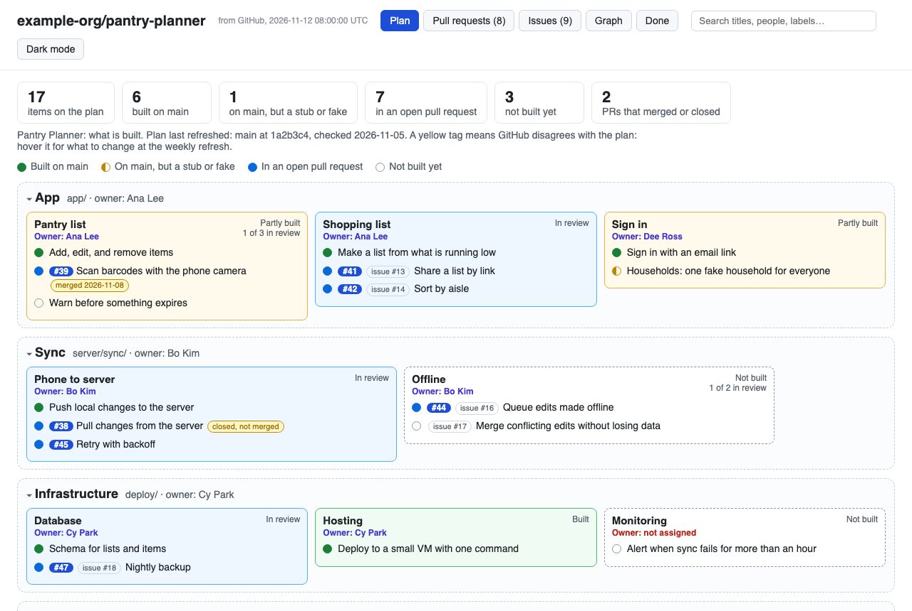
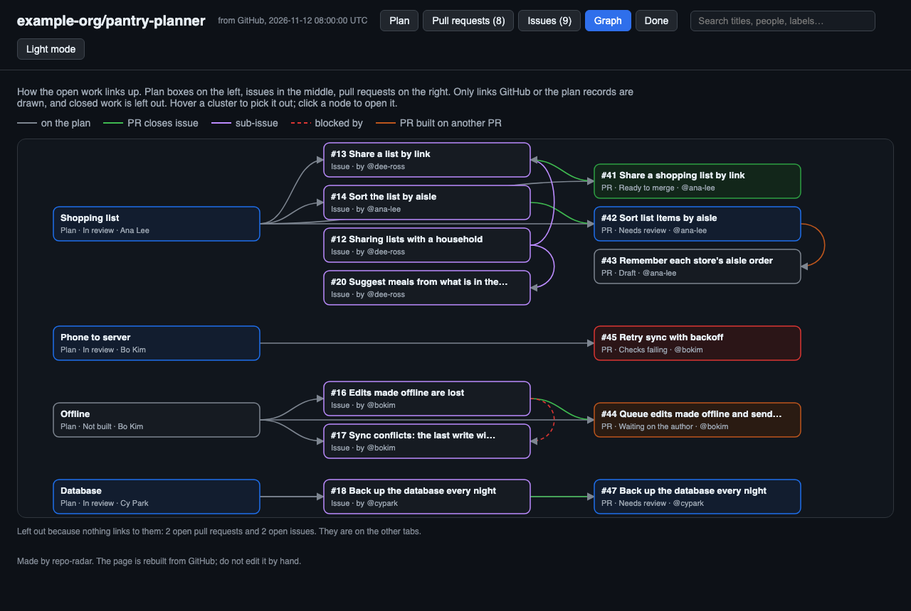
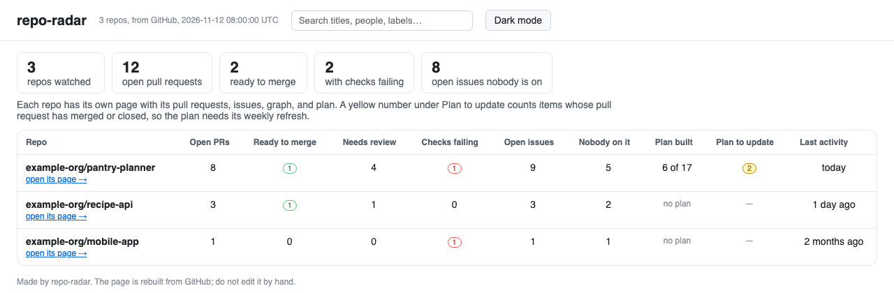

# repo-radar

Everything in your GitHub repo that needs a person, on one page, every morning.
Plus, if you want it, a map of what your team has built and what is still missing.



## Why we built this

On our team project, we had a hard time keeping track of what was already built and
what still needed building. GitHub showed us the open pull requests, but not which
part of the system each one belonged to, or which parts nobody had started yet.

repo-radar puts both on one page, rebuilt every morning: what needs a person today,
and a plan of what is built and what is still missing.

**What about GitHub's project boards?** We like them, and if your team keeps one up to
date, keep it. We needed two things a board did not give us. A board shows issues and
pull requests, so the parts of the system nobody has opened an issue for stay
invisible. And a board needs someone to add and move cards, while this page rebuilds
itself from GitHub. It stops there on purpose: the page only reads. No assigning, no
sprints, no dragging cards.

## What is on the page

| Tab | What it shows |
|---|---|
| **Plan** | Only if your repo has a plan file. Every part of the system, who owns it, and what is built, in review, or missing. A yellow tag means GitHub disagrees with the plan, such as a PR that merged. |
| **Pull requests** | Open PRs sorted by what they need: ready to merge, needs review, waiting on the author, checks failing, draft. "Start here" picks up to five. |
| **Issues** | Open issues: nobody on it yet, someone assigned, a PR open. |
| **Graph** | How the open work links up: plan box → issue → pull request. |
| **Done** | What closed in the last 90 days, under the release that shipped it. |

It is one HTML file with nothing loaded from the internet, with search, dark mode,
and links to GitHub on every item.



*Both pictures show Pantry Planner, a made-up project in `examples/demo/`.*

## Try it

You need Python 3.10 or newer, PyYAML (`pip install pyyaml`), and the
[GitHub CLI](https://cli.github.com/) (`gh`), signed in.

**With Claude Code**, install the plugin:

```
/plugin install repo-radar --marketplace sv642-hub/repo-radar
```

Then ask Claude to "set up repo-radar". It asks which of the two ways below you want,
builds the pages once so you can see them, and adds the daily rebuild.

**Without Claude**, run the script inside any repo, or name one:

```bash
python skills/repo-radar/scripts/dashboard.py build --out dashboard.html
python skills/repo-radar/scripts/dashboard.py build --repo owner/name --out dashboard.html
```

Either way, the daily rebuild is a GitHub Action with no AI in it, so it needs no API
key. The pages live on a branch called `dashboard`, replaced each day.

## For the people working on a repo

Add repo-radar to the repo itself. From its top folder:

```bash
python <path to>/skills/repo-radar/scripts/dashboard.py init
```

This adds the scripts to `.github/dashboard/` and an Action to
`.github/workflows/dashboard.yml`. Add `--with-plan` for a starter plan, or
`--plan path/to/plan.yaml` to use one you have. Commit them, and the page rebuilds
every day at 11:00 UTC (change it with `--cron`). To open today's page:

```bash
git fetch origin dashboard && git show origin/dashboard:index.html > dashboard.html
```

For a public repo, you can turn on GitHub Pages for the `dashboard` branch instead and
get a web address.

## For someone watching several repos

A manager, a teacher, or anyone following more than one team. Nothing is added to the
repos you watch: you list them in one repo of your own.



In that repo (a new, empty one is fine):

```bash
python <path to>/skills/repo-radar/scripts/dashboard.py init --watch
```

This writes `watchlist.yaml` and an Action, `.github/workflows/radar.yml`. List your
repos:

```yaml
repos:
  - my-org/api
  - repo: my-org/mobile-app
    plan: docs/architecture.yaml   # if its plan is not at docs/plan.yaml
```

Commit, and every day the Action builds a page for each repo plus an overview
comparing them: open PRs, what is ready to merge, failing checks, issues nobody is on,
how much of each plan is built, and when each repo last moved. A repo it cannot read
shows the reason on its row instead of stopping the rest. To open today's pages:

```bash
mkdir -p radar && git fetch origin dashboard && git archive origin/dashboard | tar -x -C radar
```

then open `radar/index.html`.

**Private repos:** the Action can read public repos and its own repo. To watch private
ones, create a GitHub token that can read them and save it in your watching repo as a
secret named `RADAR_TOKEN` (Settings → Secrets and variables → Actions).

## The plan file

The plan is optional. It holds what GitHub cannot know: the parts of the system
nobody has started.

```yaml
title: "Pantry Planner: what is built"
as_of: "main at 1a2b3c4, checked 2026-11-05"
people:                      # owner name -> GitHub login
  Ana Lee: ana-lee
groups:
  app:
    title: App
    owner: Ana Lee           # owns every box in the group, unless a box says otherwise
    boxes:
      - title: Shopping list
        items:
          - {status: built, text: "Make a list from what is running low"}
          - {status: pr, pr: 41, text: "Share a list by link", issue: 13}
          - {status: missing, text: "Sort by aisle"}
```

Each item is `built`, `simulated` (merged, but a stub or fake), `pr` (with its
number), or `missing`. The full format is at the top of
[`dashboard_plan.py`](skills/repo-radar/scripts/dashboard_plan.py).

To keep it current without merge fights: each pull request updates only its own items,
and once a week one person marks what merged (the page flags those) and sets `as_of`.

## How it sorts things

Only facts GitHub already has, no AI:

- **Pull requests:** draft → checks failing → changes requested → approved → anything
  else needs review. The first rule that fits wins.
- **Issues:** an open PR closes it → someone is assigned → nobody is on it.
- **Graph:** only links GitHub or the plan records: "Closes #12" in a PR, sub-issues,
  "blocked by", a PR opened on another PR's branch, a plan item naming a PR or issue.

## Commands

| Command | What it does |
|---|---|
| `dashboard.py build --out page.html` | Ask GitHub, then draw the page |
| `dashboard.py me` | One person's plan items, checked against their PRs |
| `dashboard.py init` | Add the scripts and the daily Action to a repo |
| `dashboard.py watch --out folder/` | A page per repo in `watchlist.yaml`, plus an overview |
| `dashboard.py init --watch` | Make a repo of yours watch other repos every day |
| `dashboard.py fetch --out data.json` | Save what GitHub said, to draw later with `build --data` |

Each takes `--help`. To run the tests: `uv run pytest`.

## Credits

Built by Sebastian Villalobos ([@sv642-hub](https://github.com/sv642-hub)), Verness Chin
([@verness](https://github.com/verness)), Ishika Gobin
([@ishikagobin](https://github.com/ishikagobin)), and Sharanya Atluri
([@saiatl2354](https://github.com/saiatl2354)).

Thanks to our professor, Amit Arora ([@aarora79](https://github.com/aarora79)), whose
daily triage dashboard for
[mcp-gateway-registry](https://github.com/agentic-community/mcp-gateway-registry)
inspired the morning page, and who suggested making this a skill any team can use.

## License

[MIT](LICENSE)
