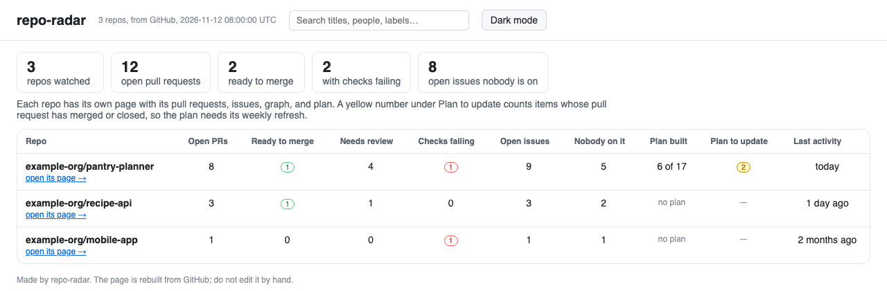

# Manager mode: overview and repo dashboards

A manager, a teacher, or anyone following more than one team. Nothing is added to the
repos you watch: you list them in one repo of your own.



In that repo (a new, empty one is fine):

```bash
python <path to>/skills/repo-radar/scripts/dashboard.py init --watch
```

This writes `watchlist.yaml` and an Action, `.github/workflows/radar.yml`. List your
repos:

```yaml
repos:
  - my-org/api
  - repo: my-org/mobile-app
    plan: docs/architecture.yaml   # if its plan is not at docs/plan.yaml
```

Commit, and every day the Action builds a page for each repo plus an overview
comparing them: open PRs, what is ready to merge, failing checks, issues nobody is on,
how much of each plan is built, and when each repo last moved. A repo it cannot read
shows the reason on its row instead of stopping the rest. To open today's pages:

```bash
mkdir -p radar && git fetch origin dashboard && git archive origin/dashboard | tar -x -C radar
```

then open `radar/index.html`.

**Private repos:** Keep the monitoring repo private when watching private repos. Its `dashboard` branch contains PR and issue titles, people, and plan details from every watched repo; a public monitoring repo exposes those details. GitHub Pages must also have suitable access controls.

**Token access:** the Action can read public repos and its own repo. To watch private
ones, create a GitHub token that can read them and save it in your watching repo as a
secret named `RADAR_TOKEN` (Settings → Secrets and variables → Actions).
