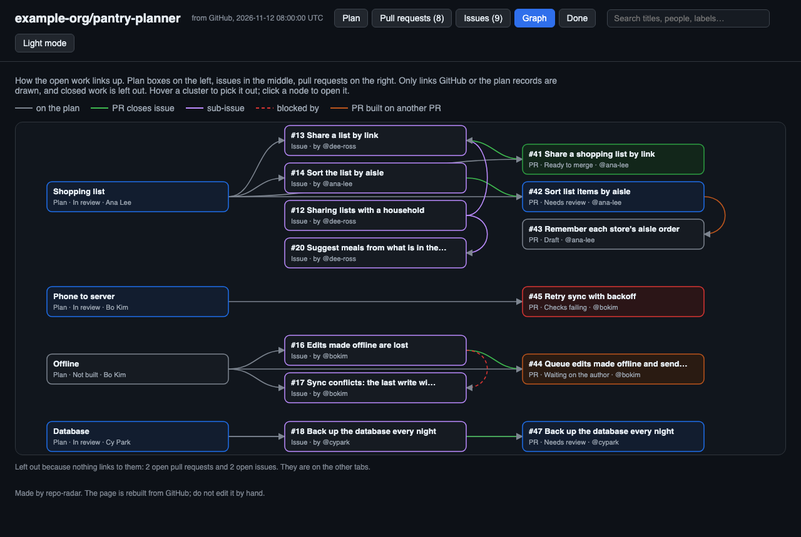

# What is on the page

| Tab | What it shows |
|---|---|
| **Plan** | Only if your repo has a plan file. Every part of the system, who owns it, and what is built, in review, or missing. A yellow tag means GitHub disagrees with the plan, such as a PR that merged. |
| **Pull requests** | Open PRs sorted by what they need: ready to merge, needs review, waiting on the author, checks failing, draft. "Start here" picks up to five. |
| **Issues** | Open issues: nobody on it yet, someone assigned, a PR open. |
| **Graph** | How the open work links up: plan box → issue → pull request. |
| **Done** | What closed in the last 90 days, under the release that shipped it. |

It is one HTML file with nothing loaded from the internet, with search, dark mode,
and links to GitHub on every item.

*The picture shows Pantry Planner, a made-up project in `examples/demo/`.*

## Two modes

| Mode | Where it runs | Dashboard structure |
|---|---|---|
| Engineer | In the repo you work on | One dashboard with Plan, PRs, Issues, Graph, and Done views |
| Manager | In a separate monitoring repo | One overview for comparing repos, with a detail dashboard per repo and a link back |

Manager mode keeps individual repo details on separate pages so unrelated plans and work do not overwhelm the comparison view. All pages are built together by the same daily job.
